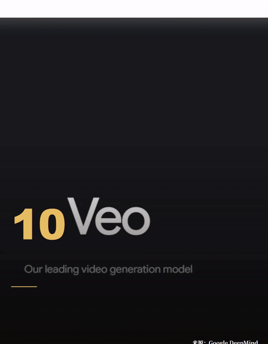
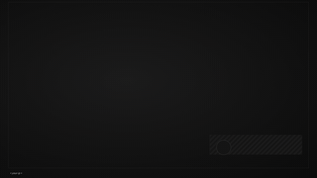
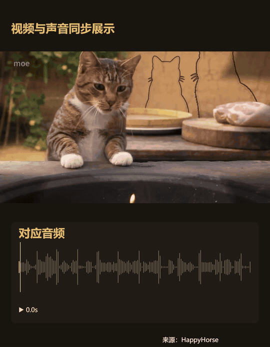

# AI 视频动效库

先看动图，再按视频内容和风格选。直接告诉AI“给这条培训回顾选合适的开头”“给工具盘点配科技感动效”即可，不需要记编号。

点击效果名称可进入详细页，查看完整动图、镜头顺序和替换内容。

## 开头

<table>
<tr>
<td width="33%" align="center"><a href="mine/openers/01-ranking-flash"><br><b>快闪榜单开场</b></a><br>已用过<br>工具盘点、产品榜单</td>
<td width="33%" align="center"><a href="mine/openers/02-grid-reveal"><br><b>九宫格纪实开场</b></a><br>已用过<br>培训活动、企业活动</td>
<td width="33%" align="center"><a href="references/openers/05-trapezoid-popups"><br><b>梯形弹窗铺屏</b></a><br>已制作待用<br>评论展示、观点集中出现</td>
</tr>
</table>

## 中间

<table>
<tr>
<td width="33%" align="center"><a href="references/middles/ai-editor-network"><br><b>暗黑科技关系网络</b></a><br>已制作待用<br>多工具协作、AI功能解释</td>
<td width="33%" align="center"><a href="mine/middles/17-video-waveform"><br><b>视频与声音波形展示</b></a><br>已用过<br>AI视频展示、音画同步说明</td>
<td width="33%" align="center"><a href="references/middles/32-title-focus"><br><b>逐字聚焦标题</b></a><br>参考待复刻<br>短标题强调、章节标题</td>
</tr>
</table>

## 结尾

<table>
<tr>
<td width="33%" align="center"><a href="mine/closers/26-follow-wall"><br><b>照片墙关注结尾</b></a><br>已用过<br>引导关注、账号收尾</td>
<td width="33%" align="center"><a href="mine/closers/27-filmstrip-typewriter"><br><b>胶片照片谢幕</b></a><br>已用过<br>活动总结、企业培训回顾</td>
</tr>
</table>

## 怎么调用

> 去 https://github.com/simpleai-ch/ai-video-motion-library 选合适的动效。内容是企业培训活动回顾，整体纪实，开头利落，结尾简洁温暖。文案和素材在……，先给动态预览。

AI会根据主题、用途、位置、风格、节奏和素材条件筛选，读取具体工程，再替换为新内容。没有匹配项时说明差距，不强行套用。

## 分类与文件

- `mine/`：在自己视频中使用过；`references/`：参考或待用。
- 两者均按 `openers/`、`middles/`、`closers/` 区分开头、中间、结尾。
- 每项先看 `README.md` 和 `preview.gif`；细查时打开带进度条的 `index.html`。
- `scene.html` 或 `render.py` 是动画工程，`config.json` 是替换配置，`meta.json` 供AI检索。
- `catalog.json` 保留风格、用途、素材需求与状态；编号只作内部兼容。

<details>
<summary>本机运行与AI复用说明</summary>

## 本机运行（可交给AI执行）

视频与开源字体使用Git LFS；安装Git LFS后执行：

```bash
git clone https://github.com/simpleai-ch/ai-video-motion-library.git
cd ai-video-motion-library
git lfs pull
python -m pip install -r requirements.txt
npm install
npx playwright install chromium
python motion.py search "培训活动回顾的纪实开头"
python motion.py new "九宫格纪实开场" 新培训视频
python motion.py validate instances/新培训视频
python motion.py render instances/新培训视频
```

FFmpeg需在PATH中，或用FFMPEG环境变量指定。可用CHROME_EXECUTABLE指定已安装Chrome。运行`python -m http.server 8000`后访问http://localhost:8000/index.html浏览预览。

原模板保留，新项目位于instances，默认不提交。默认画幅不同，换画幅时需重新排版。旧编号仅用于内部兼容，旧调用仍有效。

Noto字体许可证见shared/fonts/OFL.txt，Windows系统字体不随仓库分发。示例素材不等于授权用于任意商业发布。

</details>
