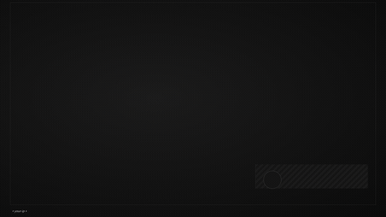

# AI剪辑器 · 关系网络（中间动效）

- **类型**：中间动效 · 来源：参考复刻（还没在自己的视频里用过）
- **风格**：暗黑科技风 MG，黑底网格 + 红/黄/蓝点缀，模拟软件界面 + 关系网络图
- **时长**：13 秒 · 16:9 · 1920×1080
- **使用**：浏览器打开 `index.html` 播放，底部可以拖进度条逐帧查看

## 镜头顺序

| 时间 | 动作 |
|---|---|
| 0.25s | 人物 + 桌椅 + 显示器从左往右滑入 |
| 1.3s | “大模型”红色标签出现，红框像卷轴一样从上往下展开 |
| 2.5s | 框内 AI 机器人图标弹出 |
| 3.0s | 显示器上出现黄点 → 折线虚线 → 第二个黄点 |
| 3.8s | 弹窗从黄点开始横向拉开，再上下展开；出现标题“AI的剪映” |
| 4.7s | 左侧文件树逐行出现 → 中间画布 → 时间轴刻度 |
| 5.7s | 四根进度条各自以不同速度、不规则地拉满（白最快、红最慢） |
| 6.1s | 公司 / 高管 / 网红 依次渐隐出现 |
| 7.5s | 13 个“平台”圆圈按 A→M 依次出现：先出现一半 → 连线到三个标签 → 再完全出现 |

## 替换内容
修改 `index.html` 中 `<script>` 顶部的 `CONFIG`：字幕、窗口标题、标签、三个分类名、圆圈文字、进度条名称、总时长。

## 待办
- 人物目前是代码画的占位版，需要替换成坐姿 IP 插画（透明 PNG，最好人物、椅子、桌子、显示器分层）。

## 素材
- `assets/reference.png`：参考截图
- `assets/ip-standing.png`：IP 站姿原图
