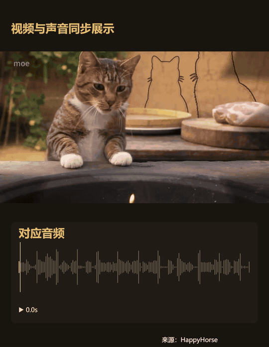

# 视频与声音波形展示

- **类型**：中间 · 自己视频里已使用
- **风格**：黑金、清晰演示、简洁
- **适合**：AI视频展示、音画同步说明、生成效果演示、带声音的视频案例
- **规格**：9.47秒 · 9:16 · 1080×1920
- **预览**：下载仓库后打开 `index.html`，可播放、暂停、重播和拖动进度；[高清MP4](preview.mp4)

GIF与预览只展示动效主体，不带示例口播人物和字幕；实际导出的画幅仍由配置决定。

## 镜头顺序

|时间|动作|
|---|---|
|0–结束|上方视频持续播放|
|随音频推进|下方真实波形随播放位置变亮|
|随时间推进|播放指针移动，时间文字同步更新|

## 替换内容

修改 `config.json`，素材放进 `assets/`；先复制实例，再改内容。

|替换什么|字段|怎么改|
|---|---|---|
|视频|`video`|换成带声音的视频案例|
|波形来源|`wave_audio`|可选；不填时从video重新分析音频|
|标题与来源|`title / source_label`|改成对应产品和素材来源|

## 怎么用

告诉AI：“从仓库选用 **视频与声音波形展示**，文案是……，素材在……，画幅是……，先给动态预览。”

- `index.html`：统一预览播放器；下载后直接打开即可看视频。
- `scene.html`：可编辑动画；通过本地HTTP服务预览时可实时拖动。
- `config.json`：替换内容。导出和运行依赖见[仓库首页](../../../README.md)。

## 素材与来源

- 工具榜单HappyHorse段
- `preview.gif`：GitHub内直接浏览的动图。
- `preview.mp4`：高清动效预览。
- `assets/`：动效使用的素材。
