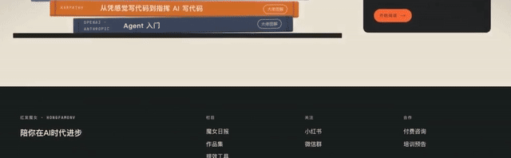

# 逐字聚焦标题

> **参考片段，不是完成的可替换模板。** 需要使用时，先按照下方轨迹复刻动态预览。

- **类型**：中间 · 仅参考，尚未复刻
- **风格**：文字为主、简洁、聚焦、精致
- **适合**：短标题强调、章节标题、关键词强调
- **规格**：1.80秒 · 16:9 · 1280×720
- **预览**：下载仓库后打开 `index.html`，可播放、暂停、重播和拖动进度；[高清MP4](preview.mp4)

GIF聚焦原参考片的标题区域。时间点为观察近似值，原作者与原网址待补充，不将其标成原创。

## 镜头顺序

|时间|动作|
|---|---|
|约0–0.23秒|参考标题开始出现|
|约0.23–1.17秒|文字从左到右依次由大且模糊收缩为清晰字形|
|约1.17–1.8秒|标题落稳后短暂停留|

## 替换内容

这里列出复刻目标，不代表已有渲染程序。

|替换什么|字段|怎么改|
|---|---|---|
|新标题|`text`|先以这个标题重建可编辑文字动画|
|画幅与时长|`width / height / duration_frames`|作为复刻目标；目前不是直接渲染配置|

## 怎么用

告诉AI：“参考仓库里的逐字聚焦标题，把文字改成……，先复刻一版预览。”

## 素材与来源

- 参考01，原作者待补充
- `preview.gif`：GitHub内直接浏览的动图。
- `preview.mp4`：高清动效预览。
- `assets/`：动效使用的素材。
